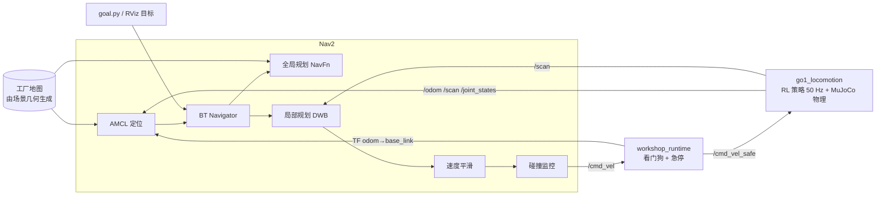

# 基于 MuJoCo 与 ROS 2 的 Unitree Go1 四足机器人工厂自主导航

> 课程选题：**B2 车间通道通行** · 第一组：教晔廷、臧文韬、牛麒皓、张欣、苏奕婷
>
> 仓库：https://github.com/richardzang2006-svg/go1-b2-navigation · 汇报 PPT：[docs/B2车间通道通行_汇报.pptx](docs/B2车间通道通行_汇报.pptx) · 课程报告：[docs/B2车间通道通行_课程报告.pdf](docs/B2车间通道通行_课程报告.pdf)

本项目让 **Unitree Go1 四足机器人** 在 MuJoCo 仿真的工厂车间中完成自主导航：从起点出发，穿过主通道，进入蛇形货架迷宫，一路避开地图上没有的临时障碍物，最终到达指定位置。

- **运动控制**：已训练好的强化学习行走策略（输入本体感受观测，输出 12 个关节目标角）
- **导航**：ROS 2 Jazzy + Nav2（AMCL 定位、全局路径规划、DWB 局部规划、速度平滑、碰撞监控）
- **仿真与可视化**：MuJoCo（真实物理与机器人画面）+ RViz（地图、激光、代价地图、规划路径）


| 货架迷宫（俯视） | Go1 视角：主通道与临时障碍物 |
| --- | --- |
|  |  |

---

## 1. 项目亮点

- **工厂场景**：27 m × 18 m 厂房，包含蛇形货架迷宫（4 个 180° 转弯，通道宽 3 m）、传送带、4 台加工设备、叉车、卷帘门和地面标线。
- **同时展示全局规划与局部避障**：场景里放了 6 处**不在导航地图上**的障碍物（托盘、锥桶、货箱、推车）。全局规划一开始会让路径穿过它们，激光发现障碍后，局部规划器绕行，全局路径随之更新。这一过程在 RViz 中可以直接看到。
- **场景与地图同源**：Nav2 地图由 MuJoCo 场景的碰撞几何自动光栅化生成，地图与仿真世界严格一致。
- **机器人模型经过逐位验证**：原始模型是编译好的二进制文件，无法直接编辑。我们把 Go1 还原成可编辑模型，再在外面搭建工厂。用同一个策略在新旧两个模型中运行，轨迹偏差为 **0**，保证步态完全不受影响。
- **多层安全机制**：Nav2 碰撞监控 → 指令看门狗（0.5 s 无指令自动停车）→ 急停服务。
- **启动更可靠**：针对 Fast DDS 偶发丢失生命周期服务应答、导致 AMCL 无法激活的问题，加入 `lifecycle_guard` 自动补全 Nav2 启动。

## 2. 系统架构



运动控制链路：Nav2 输出速度指令 → 看门狗过滤 → 策略网络根据速度指令与本体感受（机身速度、姿态、关节角/角速度、上一步动作）计算关节目标 → MuJoCo 位置执行器驱动关节。2D 激光在仿真中以 MuJoCo 射线检测实现（90 线，10 Hz）。

## 3. 运行环境

| 项目 | 版本 |
| --- | --- |
| 操作系统 | Ubuntu 24.04 |
| ROS 2 | Jazzy（需安装 Nav2：`nav2_bringup` 等） |
| Python | 3.12 |
| MuJoCo | ≥ 3.0（已在 3.15 上测试） |

## 4. 快速开始

首次构建：

```bash
cd /home/ubuntu/ros2_ws
python3 -m venv --system-site-packages .venv
.venv/bin/python -m pip install 'mujoco>=3.0'
source scripts/env.sh
colcon build --symlink-install
```

启动演示：

```bash
./scripts/start_demo.sh
```

启动后会打开 MuJoCo 窗口（相机自动跟随 Go1）和 RViz。Nav2 就绪后（约 10 秒）Go1 自动出发，终点是货架迷宫最深处 `(6.5, 8.5)`。在启动终端按 **Ctrl+C** 结束全部进程。

## 5. 演示看点

1. **全局规划**：RViz 中的红色线是全局路径，从起点沿主通道向东，在迷宫东端入口转入，蛇形穿过 4 条货架通道。
2. **局部避障**：主通道上的托盘和锥桶、迷宫里的货箱和推车都不在地图上。注意观察激光点出现后，局部代价地图上新增的障碍、蓝色的局部轨迹如何绕行，以及红色全局路径的重新规划。
3. **安全停车**：运行中可以随时触发急停（见下一节），机器人立即停下，解除后继续执行任务。急停超过约 20 秒时，Nav2 的进度检查会判定任务失败，需要重新发送目标。

## 6. 常用操作

启动参数：

```bash
./scripts/start_demo.sh auto_goal:=false                       # 不自动出发，用 RViz 的 "Nav2 Goal" 手动选目标
./scripts/start_demo.sh goal_x:=22.5 goal_y:=0 goal_yaw:=0     # 修改自动目标（地图坐标，yaw 为弧度）
./scripts/start_demo.sh world:=maze                            # 切换到早期的 S 形迷宫场景
./scripts/start_demo.sh mujoco_viewer:=false rviz:=false       # 无界面运行
```

另开终端（需先 `source scripts/env.sh`）：

```bash
ros2 run workshop_navigation goal.py 22.5 0 --yaw 0 --timeout 300                   # 发送导航目标
ros2 service call /workshop/emergency_stop std_srvs/srv/SetBool '{data: true}'      # 急停
ros2 service call /workshop/emergency_stop std_srvs/srv/SetBool '{data: false}'     # 解除急停
ros2 topic echo /workshop/status                                                    # 运行状态
ros2 topic echo /workshop/mission                                                   # 任务进度
```

可选的目标点：主通道 `(10, -0.5)`、`(22.5, 0)`，迷宫各通道 `(18.5, 4)`、`(14.5, 4)`、`(10.5, 8.5)`、`(6.5, 8.5)`，起点区 `(0, 0)`。

本项目使用 ROS 域 73 和仅本机的 DDS 发现，不会干扰同一网络中的其他 ROS 程序。

## 7. 实测结果

在无界面模式下，从起点导航到迷宫终点 `(6.5, 8.5)`，规划路径长约 49.5 m：

| 指标 | 结果 |
| --- | --- |
| 导航结果 | 2 次运行均成功（`SUCCEEDED`），未触发恢复行为 |
| 导航用时 | 44 s / 50 s |
| 最高速度（1 s 平滑） | 1.29 m/s（上限 1.5 m/s） |
| 机身高度 | 0.28–0.32 m，全程无摔倒 |
| 与临时障碍物的最近距离（机身中心） | 托盘 0.37 m，其余 0.95–1.87 m |

详细记录见 [docs/evidence/go1_factory_navigation.txt](docs/evidence/go1_factory_navigation.txt)。

## 8. 关键设计说明

**机器人模型还原与验证。** 原始的 `go1_corridor.mjb` 是编译后的二进制模型，不能追加几何体。`build_go1_factory.py` 从编译模型中逐项读出刚体、惯量、关节、执行器、网格、关键帧和地面接触参数，重建为可编辑的 `MjSpec`，再在外面搭建工厂。保存前做两步检查：

1. **静态检查**：机器人相关的全部数组与原模型一致。
2. **动态检查**：用训练好的策略分别在新旧模型中行走 8 秒（直行和转弯各一次），两边的轨迹必须完全相同。实测偏差为 0。

**几何体分组。**

| 分组 | 内容 | 碰撞 | 激光可见 | 进入导航地图 |
| --- | --- | --- | --- | --- |
| 0 | 墙、货架、设备等固定障碍 | ✓ | ✓ | ✓ |
| 1 | 地面标线、灯具等装饰 | ✗ | — | ✗ |
| 2 | 临时障碍物（托盘、锥桶、货箱、推车） | ✓ | ✓ | ✗ |

**速度设定。** 策略在 0.3 m/s 以下存在跟踪死区，所以 Nav2 的最小速度设为 0.28 m/s、最小角速度设为 0.6 rad/s。在平地上测试时，策略在 1.5 m/s 以内跟踪良好，直行、转弯、急停再起步都能保持稳定，因此导航上限设为 1.5 m/s。注意：1.5 m/s 已超出策略原始文档给出的 1.0 m/s 范围，只在本项目的平整地面上验证过。

**迷宫尺寸。** 早期 S 形迷宫的转弯开口只有 2.1 m，Go1 会卡在掉头处。新迷宫的通道和转弯开口统一为 3.0 m，临时障碍物旁至少留 2.1 m 通行宽度。

## 9. 修改场景后重新生成

```bash
source scripts/env.sh
.venv/bin/python go1_mujoco_locomotion/scripts/build_go1_factory.py            # 生成场景并自动验证
.venv/bin/python src/workshop_navigation/scripts/generate_go1_factory_map.py   # 生成对应地图
colcon build --symlink-install --packages-select go1_mujoco_locomotion workshop_navigation
```

场景布局写在 `build_go1_factory.py` 的 `Factory.build()` 中。修改布局后，务必同步调整 `generate_go1_factory_map.py` 中的厂房边界。

## 10. 目录结构

```
ros2_ws/
├── go1_mujoco_locomotion/              # Go1 运动层（ROS 2 Python 包）
│   ├── go1_mujoco_locomotion/locomotion_node.py   # 策略推理 + MuJoCo 仿真 + 话题发布
│   ├── config/                         # 策略权重、观测归一化、场景 .mjb、参数
│   └── scripts/build_go1_factory.py    # 工厂场景生成与验证
├── src/workshop_navigation/            # 导航层（ROS 2 包）
│   ├── launch/go1_mujoco.launch.py     # 一键启动：仿真 + Nav2 + RViz + 自动目标
│   ├── config/go1_mujoco_nav2.yaml     # Nav2 参数
│   ├── maps/go1_factory.{pgm,yaml}     # 由场景生成的地图
│   └── scripts/                        # 看门狗、目标发送、生命周期守护、地图生成
├── scripts/                            # 环境配置、启动与验证脚本
└── docs/                               # 截图与运行记录
```

`src/` 中的 Unitree Go2、ANYmal 等目录是早期方案留下的参考代码，带 `COLCON_IGNORE`，不参与构建。

## 10.5 Go2 地形导航扩展

仓库新增 `go2_mujoco_locomotion/` 包，用同一套 ROS 2 / Nav2 接口展示 Go2
在低台阶和斜坡地形上的运动能力。它与 Go1 平地工厂 demo 独立启动，不改变
原有 `workshop_navigation` 的行为。

```bash
colcon build --packages-select go2_mujoco_locomotion
ros2 launch go2_mujoco_locomotion go2_terrain.launch.py
```

包含 0.06 m/0.14 m 台阶、低斜坡、对应可通行地图和 45 维本体感受策略。
详细说明见 [go2_mujoco_locomotion/README.md](go2_mujoco_locomotion/README.md)，
验证记录见 [docs/evidence/go2_terrain_navigation.txt](docs/evidence/go2_terrain_navigation.txt)。

## 11. 已知限制

- **只能在平地上行走**：行走策略只使用本体感受，没有地形感知，实测台阶高度超过约 1.5 cm 就无法通过。
- **碰撞模型简化**：仿真中只有四只脚参与碰撞，小腿和机身不会与障碍物发生接触。导航依靠代价地图保持安全距离。
- **只能前进，不能横移**：策略未训练横向移动，转向依靠原地或行进中旋转。
- **仅在仿真中验证**：策略的观测里包含机身线速度，在实机上需要额外的状态估计。

## 12. 未来工作

- **台阶区域**：在工厂中加入上下台阶区，与现有导航融合。需要重新训练带地形感知（高度扫描或教师-学生蒸馏）的策略，并补全腿部和机身碰撞、加入地形难度课程；导航层面要把台阶区标为可通行的限速区，并在进入时切换策略。
- **动态障碍物**：加入移动的叉车或行人，测试动态避障。
- **多点巡检任务**：用 waypoint follower 实现按顺序巡检多个工位。

## 13. 致谢与第三方组件

- Go1 机器人模型来自 [MuJoCo Menagerie](https://github.com/google-deepmind/mujoco_menagerie)（BSD-3-Clause）
- 导航基于 [Navigation2](https://github.com/ros-navigation/navigation2)
- 行走策略权重的来源说明见 [THIRD_PARTY.md](THIRD_PARTY.md)
